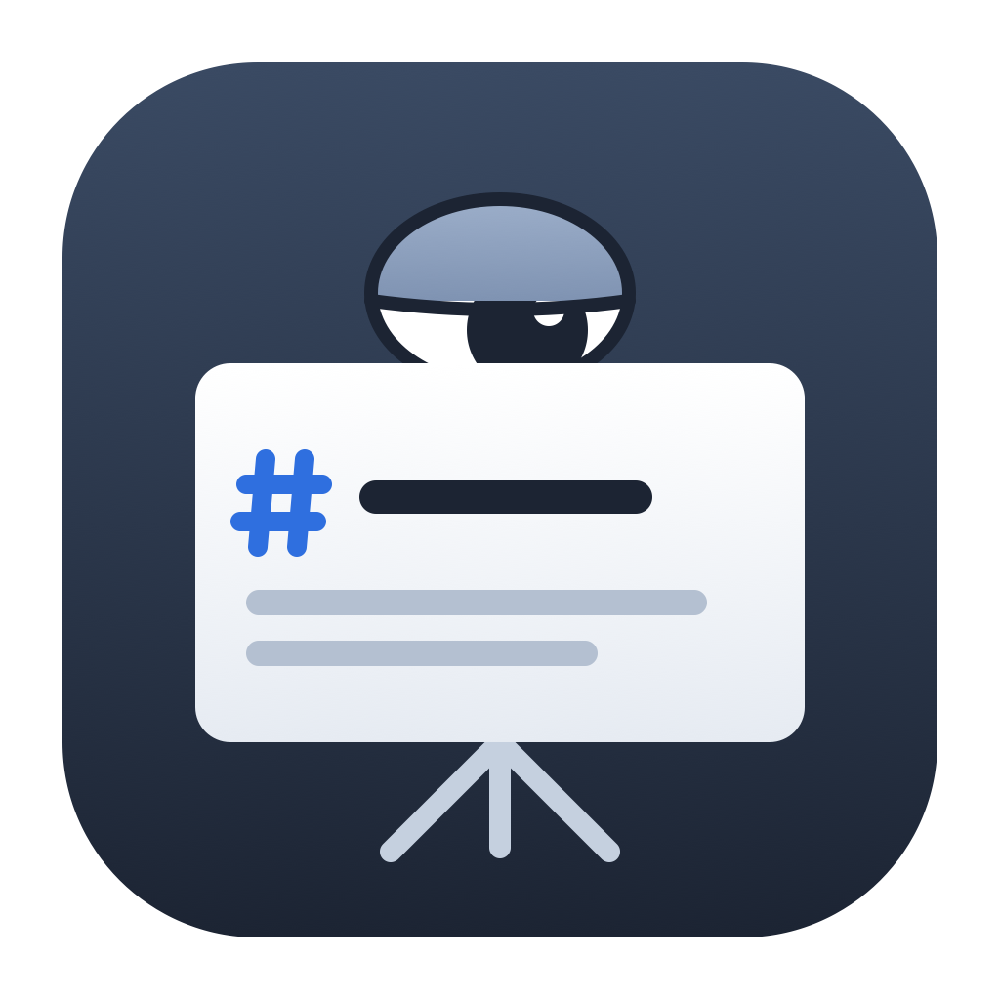
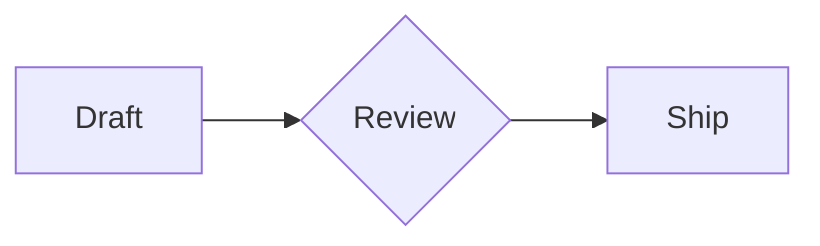

<p align="center">
  
</p>

<h1 align="center">dullview</h1>

<p align="center">
  <a href="https://github.com/vangheem/dullview/releases/latest"></a>
  <a href="https://github.com/vangheem/dullview/actions/workflows/ci.yml"></a>
  <a href="LICENSE"></a>
</p>

A folder of markdown files as a slide deck. Templates handle the layout, PowerPoint templates import, and slides update as you save. Built with [Rune](https://github.com/anomalyco/rune), a GPU-rendered Rust UI framework.

## Install

### Homebrew (macOS and Linux x86_64)

```sh
brew install vangheem/tap/dullview
```

On macOS this also adds **dullview.app** to `~/Applications`, so you can open it from Spotlight, Launchpad or the Dock (`dullview install-app` / `uninstall-app` redo or undo that; dullview also adds it on its first run). `brew upgrade dullview` updates both.

### Prebuilt binaries

Tagged releases (`v*`) are on the [releases page](https://github.com/vangheem/dullview/releases),
and every push to `main` refreshes the
[`latest` prerelease](https://github.com/vangheem/dullview/releases/tag/latest).

| Platform | Asset |
| --- | --- |
| macOS (Apple silicon and Intel) | `dullview-macos-universal.tar.gz` |
| Linux x86_64 | `dullview-linux-x86_64.tar.gz` |

```sh
curl -L https://github.com/vangheem/dullview/releases/latest/download/dullview-macos-universal.tar.gz | tar xz
./dullview --init my-talk
```

### From source

```sh
make install   # cargo build --release, copies dullview to ~/.local/bin, and adds dullview.app on macOS
```

## Use

```sh
dullview                                          # start screen: open a presentation or a recent one
dullview --init path/to/pres                      # create a starter deck
dullview path/to/pres                             # present a folder
dullview talk.tar.gz                              # or an archive (.zip, .tar, .tar.gz, .tgz, .tar.bz2, .tar.xz)
dullview --import-potx brand.potx path/to/pres    # add a PowerPoint template's layouts
dullview --templates path/to/pres                 # list a deck's templates and placeholders
```

### Opening presentations

- **File → Open Folder…** (⌘O) opens a deck folder; **File → Open Archive…** (⇧⌘O) opens a `.zip` or tar archive of one. Dropping a folder or archive on the window works too.
- An archive is unpacked into dullview's cache (`~/Library/Caches/dullview` on macOS, `~/.cache/dullview` elsewhere). If it holds a single folder, that folder is the deck. Replacing the archive reloads it.
- **File → Close Presentation** (⇧⌘W), or **← All presentations** in the slide overview, goes back to the start screen.
- Started without a presentation, dullview shows a start screen with your recent presentations and a preview of each one's first slide; click one to open it. The list lives in `~/.config/dullview/config.json` (or `$XDG_CONFIG_HOME/dullview`).
- Fonts load when dullview starts, so a deck opened later that ships its own font files shows them after you start dullview with that deck.

## A deck

```
pres/
  001-intro.md        # one file = one slide, in filename order
  002-agenda.md
  _templates/
    default.md        # used when a slide doesn't name a template
    title.md
    section.md
    media/            # pictures templates use
    fonts/            # .ttf/.otf files templates can name
  assets/             # images, referenced as 
  variables.yaml      # deck-wide settings (text_size) and placeholders
```

- Every top-level `*.md` file is a slide, except `README.md` and files starting with `.`.
- Images can be referenced as `assets/pic.png` or `./assets/pic.png`. They're shrunk to fit the slide.

## Live reload

dullview checks the deck about every 250 ms for changes to slides, templates and images, and redraws when something changes. You stay on the slide you were viewing, even if slides are added or renamed around it.

## Sizing

Slides are designed 1280 points wide, 1280×720 by default, and scaled to fit the window. A template's `aspect` (`4:3`, say) changes the height. When the window's shape doesn't match, the slide gets black bars. `padding` is in points at that design size, and font sizes scale with the window.

## Slides

Front matter picks a template and fills in its placeholders. The markdown after the front matter becomes `{{body}}`.

```markdown
---
template: title
title: My Presentation
subtitle: Made with dullview
---
Optional body text.
```

Front matter values are one line. To fill another placeholder with markdown (a second column, say), put it in a `::: name` section:

```markdown
---
template: two-columns
title: Before and after
---
- Keyword search

::: body2
- Hybrid retrieval
:::
```

### Diagrams

` ```mermaid ` code blocks draw as diagrams: flowcharts, sequence diagrams and state diagrams. They use the slide's colours, scale with its text (and `text_size`), and shrink to fit their area. Other diagram types show as code.

````markdown

````

### Author notes

Everything below the first `---` line in a slide's body is author notes. Notes never appear on the slide. Press **N** to show them in a panel under the slide. A `---` inside a code block doesn't count, but it means a slide can't use `---` as a horizontal rule (use `***` instead).

```markdown
---
title: Agenda
---
- Point one
- Point two

---
Pause here and ask for questions.
```

## Variables

An optional `variables.yaml` in the deck folder holds deck-wide settings and placeholders, as flat `key: value` lines:

```yaml
# Text size in percent: 90 shrinks all text, 110 grows it.
text_size: 100
author: Your Name
```

- `text_size` scales all slide text, including code and imported templates, on top of each template's own `scale`. `110` and `110%` both work; the default is 100.
- Every other key is a placeholder all slides can use (`{{author}}`). A slide's own front matter overrides it.
- Keys that slides can set work here too, for every slide: `template: my-layout` changes the default template, and `background:` overrides every template's background.
- Changes reload like any other file.

## Templates

Templates live in the deck's `_templates/` folder. A template is markdown with `{{placeholders}}`, plus front matter for its look:

```markdown
---
background: "#0f1115"
background_image: media/bg.png   # relative to _templates/, covers the slide
color: "#f2f2f2"
accent: "#7aa2f7"
align: center      # left | center | right
valign: center     # top | center | bottom
padding: 96
scale: 1.2         # text size multiplier
font: "Open Sans"  # body text
heading_font: "Montserrat"
aspect: "16:9"
---
# {{title}}

### {{subtitle}}

{{body}}
```

- Any slide front matter key can be used as a placeholder. `{{body}}`, `{{slide}}` and `{{total}}` are always set.
- A line whose placeholders are all empty is dropped, so an unset `### {{subtitle}}` leaves no blank heading.
- A slide can override any of these keys in its own front matter. A slide's `background_image` is relative to the deck.
- `align: center` or `right` positions each paragraph, heading or list as a block. Lines inside a wrapped paragraph stay left-aligned.
- If `_templates/default.md` is missing, a plain built-in template (just `{{body}}`) is used. If a slide names a template that doesn't exist, the slide shows an error.

### Placed areas, pictures and boxes

Markdown outside these flows in the padded content area. These place things at a fixed spot, with `x`, `y`, `w` and `h` as fractions of the slide:

```markdown
::: box x=0 y=0.92 w=1 h=0.08 fill=#00206b
::: image x=0.04 y=0.93 w=0.1 h=0.05 src=media/logo.svg
::: area x=0.06 y=0.08 w=0.88 h=0.17 valign=bottom scale=0.9
# {{title}}
:::
::: area x=0.06 y=0.27 w=0.43 h=0.64
{{body}}
:::
::: area x=0.51 y=0.27 w=0.43 h=0.64
{{body2}}
:::
```

- `area` holds markdown up to the closing `:::`. It takes `align`, `valign`, `scale`, `color`, `font`, `heading_font` and `fill`.
- `image` fits a picture into its box; `fit=cover` fills the box instead. `radius` rounds its corners.
- `box` is a filled rectangle: `fill`, `radius`, or `shape=ellipse`.
- Boxes and pictures draw first, then the flowing markdown, then areas on top.

### Fonts

`font` and `heading_font` take a family name: one installed on the computer, or one from a `.ttf`, `.otf` or `.ttc` file anywhere in the deck (`_templates/fonts/` is a good place). Font files load at startup, so a new one needs a restart.

## Importing PowerPoint templates

```sh
dullview --import-potx brand.potx path/to/pres
dullview --templates path/to/pres
```

A `.potx` usually holds a few example slides and dozens of layouts behind them. The import turns the layouts those example slides use into templates in `path/to/pres/_templates/`, plus the master's plain "Title and Content" layout for slides that don't name a template. `--all-layouts` imports every layout instead. If the file has no slides, every layout is imported. `.pptx` files work too.

`dullview --templates` lists what a deck has:

```
default                         title, subtitle, body
title-and-content-with-bullets  title, subtitle, body
title-slide-green-no-photo      title, subtitle, author, speaker_title, date
two-columns                     title, subtitle, body, body2
```

- **Names:** each template is named after its layout (`two-columns.md`); PowerPoint's `1_` copy prefix is dropped. Pictures go to `_templates/media/`.
- **Placeholders** become areas at the same positions: `{{title}}`, `{{subtitle}}`, `{{body}}`, `{{body2}}`, …, numbered in reading order. A placeholder with a custom prompt is named after it, so "Speaker Title" becomes `{{speaker_title}}`. Prompts that mean a common key use it: "Subheadline" becomes `{{subtitle}}` and "Speaker Name" `{{author}}`. Each template's front matter lists its placeholders and prompts in comments.
- **Subtitles:** a layout without a subtitle placeholder shows `{{subtitle}}` under the title.
- **No body area:** some layouts, such as most title slides, have nowhere for body text. Their templates say so in a comment, and a slide's text after the front matter isn't shown there.
- **`default.md`:** made from the "Title and Content" layout when the deck doesn't have one. An existing `default.md` is kept; the import says so.
- **Text sizes, colours, alignment and fonts** come from the layout, its master and the theme. "Arial Bold" becomes Arial, since headings are already bold. Text that doesn't fit its area runs past it, as in PowerPoint; `text_size` in `variables.yaml` shrinks a dense deck.
- **Backgrounds** (solid, picture, or the first colour of a gradient), **pictures** (SVG preferred) and **filled rectangles and ellipses** carry over. Static text such as a copyright line becomes an area, and slide number fields become `{{slide}}`.
- **Skipped:** EMF/WMF/TIFF pictures, charts, tables, embedded objects, lines and other shapes. The import prints what it skipped.

Importing again overwrites templates with the same names and leaves the rest of the deck alone.

## Limitations

- Front matter is flat `key: value` pairs only; use `::: name` sections for multi-line values.
- Imported templates approximate the PowerPoint layouts: no gradients, effects, or shape geometry beyond rectangles and ellipses.

## Keys

| Key                        | Action         |
| -------------------------- | -------------- |
| → ↓ Space Enter PageDown   | Next slide     |
| Right-click                | Next slide     |
| ← ↑ Backspace PageUp       | Previous slide |
| Home / End                 | First / last   |
| N                          | Show/hide notes |
| O, or the ☰ button         | Slide overview (Esc closes) |
| ⌘F                         | Full screen    |

Drag across slide text to select it, and ⌘C copies it (double-click selects a word, triple-click a paragraph).

Move the mouse and a ☰ button appears at the bottom left for a few seconds. It opens a scrollable overview of every slide; click one to jump to it.

## Headless

Rune's tooling flags go after the deck path, e.g. `dullview pres --snap out.png`.
